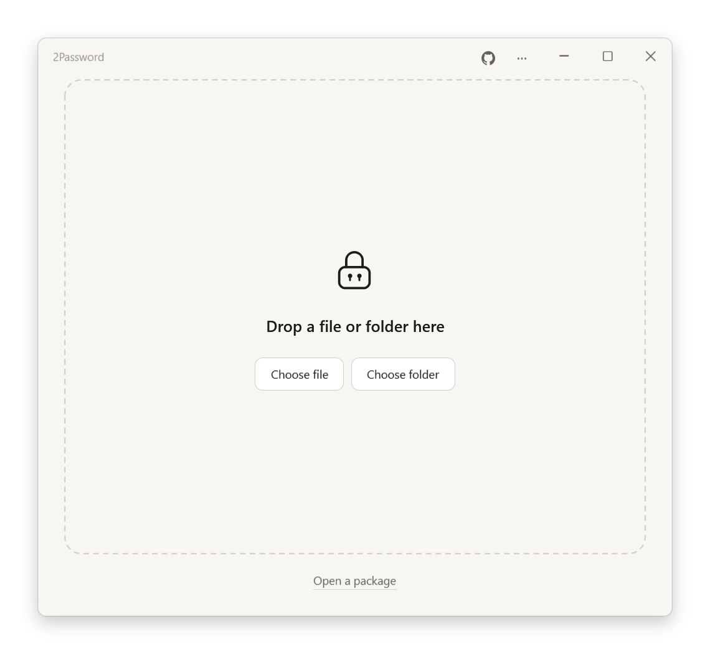

# 2Password

**One encrypted package. Multiple independent passwords.** A local Windows application for file encryption, standalone extraction, and PAR2 recovery.

> Any one password unlocks all contents. Knowing one password does not reveal any of the other passwords.

[简体中文](README.md) · English

[](https://github.com/WAcry/2Password/actions/workflows/build-release.yml)



## Download and run

Download from [GitHub Releases](https://github.com/WAcry/2Password/releases/latest):

| File | Purpose |
| --- | --- |
| `2Password-VERSION-win-x64-zh-CN.msi` | Chinese installer for the current user, with a Start Menu shortcut and uninstall support |
| `2Password-VERSION-win-x64-en-US.msi` | English version of the same installer |
| `2Password-VERSION-win-x64.exe` | Complete portable application; run directly |
| `2Password-VERSION-win-x64-portable.zip` | Portable application, documentation, and third-party notices |
| `SHA256SUMS.txt` | SHA-256 checksums for release assets |
| `par2cmdline-turbo-1.5.0.tar.xz` | Complete corresponding source for the bundled PAR2 tool |

The application targets **Windows 10 / 11 x64**. Both the application and generated extraction EXEs include the .NET runtime. Recipients do not need to install 2Password, .NET, an archive utility, or PAR2. On first use, the single-file runtime extracts its bundled native components into a cache writable by the current user.

The GUI supports **English and Simplified Chinese**. Choose a language in the application, or use `--language en` / `--language zh-CN`. The installation wizard language and the application's language can be selected independently.

The MSI installs for the current user without requiring administrator privileges. Installing the other language edition replaces the existing edition, including at the same version, instead of creating a second product.

The release currently has no configured code-signing certificate, so Windows may display “Unknown publisher.” Check the release checksums and obtain the program from a trusted source. An unfamiliar encrypted EXE can also be opened as data in a trusted installed copy of 2Password, without executing that EXE.

## Using the application

1. Select or drag in one file or folder.
2. Set and confirm **1–16 different passwords**. The GUI requires at least eight characters; longer, unpredictable passphrases are preferable. Leading and trailing spaces are significant, and Unicode normalization is not applied.
3. Choose Zstd, Brotli, or no compression. Zstd is the default.
4. Choose the package layout. Both GUI and CLI creation default to 10% PAR2 recovery data. The GUI also offers 5%, 20%, and disabled options.
5. Create the package and keep or send all files listed in the result. The source files are retained.

A recipient opens the extraction EXE, enters **any one** of the passwords, and selects a **new directory that does not already exist**. The original top-level file or folder name is retained within that directory. The destination is published only after the complete package has passed authentication and structural checks.

Passwords are independent access keys: **any one password unlocks all contents, but knowing it does not reveal the other passwords.** They are not multiple factors that must be entered together.

### Single EXE and large packages

| Layout | Behavior |
| --- | --- |
| Auto, the default | Produces one EXE when the final encrypted package fits; otherwise automatically produces an EXE and a data file |
| Embedded EXE | Stores the program and encrypted data together; explicitly fails if the result would exceed `4,294,967,295` bytes |
| EXE + data file | Always creates a standalone launcher and a sibling `.2pw` encrypted data file |

For example:

```text
Documents.exe
Documents.2pw
```

A detached package still requires no installation or separately installed runtime. **Keep both files in the same directory and retain the data filename.** The launcher contains a validated relative reference, independent of the creating computer's absolute paths. The main application can also open the `.2pw` file directly.

Windows imposes a loader limit on executable size. Tests on a real Windows system confirmed that an executable of `4 GiB - 1` bytes can launch while `4 GiB` is rejected. External data avoids generating an EXE that Windows cannot open. The launcher includes the full runtime and is approximately 64 MiB; it remains usable on a machine with no prerequisites installed.

### Recovery data

When PAR2 is enabled, the application also generates an index and recovery volumes, such as:

```text
Documents.exe.par2
Documents.exe.vol000+NNN.par2
Documents.exe.volNNN+NNN.par2
...
```

Recovery data protects the **ciphertext, container metadata, and launcher itself**. Creating, verifying, and repairing it requires no password.

Healthy packages use the normal authenticated streaming extraction path without a separate full-file PAR2 scan. If validation detects damage and matching recovery data is available, the application repairs copies of the encrypted input first, then restarts authenticated extraction. An ordinary incorrect password does not trigger automatic PAR2 work. You can explicitly select verification before extraction, use `--verify-first`, or use the separate verification and repair page.

- Repair runs in a private workspace. Reconstructed files must pass independent length and digest checks before replacing the damaged files; originals are retained as `.2pw-before-repair-*.bak` backups.
- Repeated metadata in intact recovery volumes can replace a missing or damaged index.
- Insufficient recovery data causes failure without publishing a partial repair. Recovery data does not replace offline backups.
- A 10% recovery setting describes recovery blocks. It **does not guarantee repair of any possible distribution of damage affecting 10% of the bytes**. Damage spread, missing volumes, and block size affect the result.
- PAR2 uses its format's MD5/CRC damage detection. AES-GCM still provides payload authentication. Successful repair never bypasses password verification or content authentication, and the program does not automatically execute a repaired EXE.

## Encryption design

The project uses established implementations: .NET AES-GCM, an Argon2id library, and independently checked public cryptographic test vectors. It does not implement cryptographic primitives from scratch.

Each package receives a random 256-bit content key. Each password has a separate random salt and derives a separate wrapping key using **Argon2id with 64 MiB of memory, three iterations, and four lanes**. AES-256-GCM wraps the content key independently for each password. A valid password opens its own slot; the package does not store plaintext passwords or a table that exposes the other passwords.

Data is processed in **1 MiB blocks**:

```text
PAX archive stream → independent Zstd/Brotli block compression → AES-256-GCM
```

Blocks that do not benefit from compression are stored as authenticated raw blocks. Block order, codec, raw length, encoded length, and the complete logical header digest participate in authentication. An authenticated final record is mandatory.

Critical headers, footers, and detached references have three checksummed copies. Conflicting valid copies are rejected. Directory information and filenames are inside the encrypted PAX stream; extraction does not need an entire central archive index or block-offset table in memory. Optional PAR2 also protects the complete package, including this metadata.

Someone without a valid password can attempt offline password guessing or attack the implementation or operating environment. This project has not received an independent external security audit. **The weakest valid password determines the package's resistance to guessing.** Anyone who knows one password can read, copy, share, or re-encrypt all plaintext. Changing access requires creating and distributing a new package; already distributed old copies cannot be revoked.

Outer file size, compression selection, password-slot count, and aggregate statistics are visible. Original filenames, directory structure, and file contents are encrypted. Container authentication does not establish the provenance of the EXE prefix, so executable trust and code signing remain separate concerns. See [Security design and limitations](docs/SECURITY.en.md) and the [format specification](src/TwoPassword.Core/CoreDesign.md).

## Filenames, long paths, and exact restoration

- Names use strict UTF-8 and retain their original Unicode code points. Chinese, Japanese, Arabic, accented characters, emoji, and visually similar but differently encoded NFC/NFD names remain distinct.
- File contents are read as bytes. UTF-8, UTF-16, GBK, Shift-JIS, and other text encodings are not converted, and binary files are not reinterpreted.
- Windows extended-length paths and a `longPathAware` manifest avoid the traditional 260-character restriction without changing the machine's long-path registry setting. Tests include paths longer than 1,000 characters; Windows, individual path components, and the destination filesystem still impose limits.
- Empty files and directories, hidden/system entries, creation and modification times, and common attributes are preserved within the destination filesystem's capabilities.
- The ordinary download marker `Zone.Identifier` is preserved byte for byte up to 64 KiB.
- Path traversal, device names, case collisions, existing destinations, and names that cannot be restored without loss are rejected.
- Symbolic links, directory junctions, other reparse points, EFS, offline placeholders, and other NTFS alternate data streams produce explicit errors; they are **never silently skipped**. Fully download cloud files before packaging them.
- Special Win32 names ending in dots or spaces are unsupported. Hard links are archived as separate file contents, without preserving the link relationship. Original ACLs/owners, sparse allocation layout, and NTFS compression state are not preserved.

Source inventories and metadata are checked before and after packaging. Files are opened without allowing concurrent writers or deletion while being read. This is not a VSS snapshot; stop applications that continually modify the source, or first export a consistent backup using the relevant application.

Extraction uses a new private staging directory accessible to the current user and SYSTEM. Only a complete successful result is renamed to the new destination, without overwriting existing data. Failures and cancellation clean up incomplete results. Creation does not generate an intermediate plaintext TAR file; package assembly and PAR2 repair use encrypted temporary files. Allow sufficient space for the source, output, and extraction or repair workspace.

## Development and builds

Use Windows x64, Git, and the exact .NET SDK specified in [global.json](global.json), currently **10.0.114**. WiX 4.0.6 is installed locally under `.tools` and runs on the maintained runtime using a process-scoped roll-forward setting. The icon and pinned PAR2 components are in the repository. Normal builds do not require Python; only regenerating the icon requires Pillow.

```powershell
git clone https://github.com/WAcry/2Password.git
cd 2Password
dotnet restore 2Password.slnx --locked-mode
dotnet build 2Password.slnx -c Release
dotnet run --project tests/TwoPassword.Tests -c Release
dotnet run --project tests/TwoPassword.Recovery.Tests -c Release
pwsh -File scripts/Build-Release.ps1
pwsh -File scripts/Test-Standalone.ps1
pwsh -File scripts/Test-Installer.ps1
```

Installers, the portable EXE, ZIP, and checksums are written to `artifacts/release/`. A development build does not contain the full runtime. Use the published EXE when creating standalone packages, or explicitly supply a published template through `--stub`.

The installer test first refuses to touch an existing installation of this product. It installs into an isolated directory with Unicode and spaces, checks file hashes and the current-user shortcut, tests switching installer language at the same version, and uninstalls. It retains logs and a synthetic unowned file to demonstrate that uninstall preserves user data.

Run the separate large-file checks with approximately 30 GiB of free space:

```powershell
pwsh -File scripts/Test-LargeFiles.ps1
```

Reports are saved under the Git-ignored `artifacts/` directory. Coverage includes independent passwords, public cryptographic vectors, long and multilingual paths, hostile archive/recovery metadata, repeated and truncated blocks, decompression limits, cancellation and overwrite protection, actual PAR2 damage repair, and actual standalone EXEs. Large-file tests include uncompressed data exceeding 4 GiB and a PAX file exceeding 8 GiB, with complete SHA-256 comparisons. See [verification records](docs/VALIDATION.md) for the recorded runs.

### Automated releases

[GitHub Actions](.github/workflows/build-release.yml) builds, tests, and packages the application on pushes and pull requests, then uploads artifacts. A `vMAJOR.MINOR.PATCH` tag creates a GitHub Release only after its build and verification job succeeds. Release assets include both installer languages, the portable application, checksums, and corresponding PAR2 source.

### Command line

```text
2Password.exe --help --language en
2Password.exe --inspect package.exe --report new-report.json --language en
2Password.exe --create SOURCE --output package.exe --passwords-stdin --compression zstd --layout auto --recovery-percent 10 --report new-report.json
2Password.exe --extract package.exe --output NEW_DIRECTORY --password-stdin --report new-report.json
2Password.exe --extract package.exe --output NEW_DIRECTORY --password-stdin --verify-first --language en
package.exe --extract-self --output NEW_DIRECTORY --password-stdin --report new-report.json
2Password.exe --verify-recovery package.exe.par2 --report new-report.json
2Password.exe --repair-recovery package.exe.par2 --report new-report.json
2Password.exe --export-recovery-source new-source.tar.xz
```

Use `--language en` or `--language zh-CN` to select English or Simplified Chinese messages. Package bytes, filenames, and password semantics are independent of the interface language.

Creation reads a JSON array of passwords from UTF-8 standard input. Extraction reads one password and removes only the final input line ending. Passwords are not accepted as command-line arguments, where they could appear in process listings. Report paths must name new files. Automated tests use clearly synthetic passwords and data, never personal documents.

## Established components

| Component | Purpose |
| --- | --- |
| .NET 10 WPF | Native Windows GUI, DPI handling, input, and file selection |
| System.Security.Cryptography | AES-256-GCM, random numbers, and SHA-256 |
| Konscious.Security.Cryptography.Argon2 1.3.1 | Argon2id password derivation |
| System.Formats.Tar / PAX | Streaming archives, long names, and Unicode |
| ZstdSharp.Port 0.8.8 / Zstandard 1.5.7 | Independent Zstd block compression |
| System.IO.Compression | Independent Brotli block compression |
| par2cmdline-turbo 1.5.0 | PAR2 recovery data, verification, and repair |
| WiX Toolset 4.0.6 | Windows MSI installers |

Dependency versions and NuGet content hashes are locked. PAR2 binary/source checksums are recorded in [vendor/par2](vendor/par2/README.md). Complete third-party license notices are in [THIRD-PARTY-NOTICES.txt](THIRD-PARTY-NOTICES.txt). The PAR2 executable, license, and complete corresponding source are embedded in the portable application and standalone extraction EXEs and can be exported offline.
