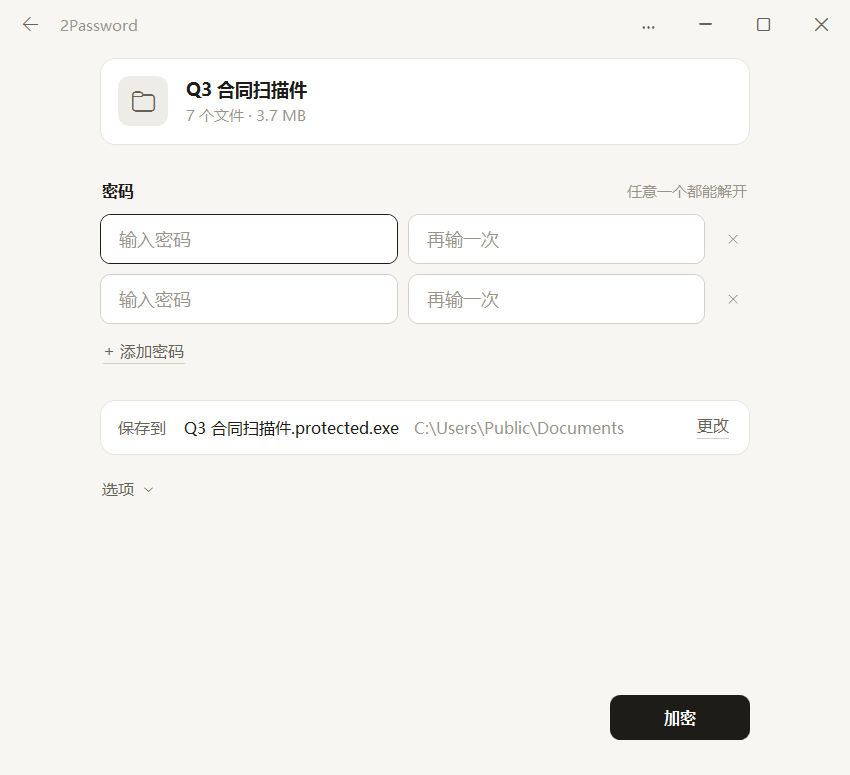

# 2Password

[简体中文](README.md) · [English](README.en.md)

把文件或文件夹加密成一个 EXE，设几个密码，任意一个都能打开。收到的人双击就能解密，什么都不用装。

[](https://github.com/WAcry/2Password/actions/workflows/build-release.yml)



## 能做什么

- 一个加密包最多设 16 个密码，每个都能单独解开全部内容。知道其中一个，推不出其他的。
- 生成的 EXE 自带运行环境，在 64 位 Windows 10 / 11 上双击就能解密。
- 默认在加密包里存一份 5% 的 PAR2 恢复记录，不会多出文件。加密包有损坏时，解密会先修好一份副本再解开，原文件不动。
- 加密后超过 4 GB 时，会拆成 `资料.exe` 和 `资料.2pw` 两个文件，恢复记录在 `.2pw` 里。两个文件放在同一个文件夹里就能用。
- 文件名（任何语言和 emoji）、空文件夹、时间和文件属性原样还原。已有的文件不会被覆盖。

## 下载

在 [Releases](https://github.com/WAcry/2Password/releases/latest) 页面选一个：

| 文件 | 说明 |
| --- | --- |
| `2Password-版本-win-x64-zh-CN.msi` | 中文安装包，装在当前用户下，不需要管理员权限 |
| `2Password-版本-win-x64-en-US.msi` | 英文安装包 |
| `2Password-版本-win-x64.exe` | 便携版，直接运行 |
| `2Password-版本-win-x64-portable.zip` | 便携版和说明文档 |

两个安装包只有安装向导的语言不同，装好后都能在程序菜单里切换中英文。发布版没有代码签名，Windows 可能提示“未知发布者”，可以用 `SHA256SUMS.txt` 核对下载的文件。

## 怎么用

**加密**：把文件或文件夹拖进窗口，输入密码，点“加密”。完成页会列出生成的文件，把它们一起发给对方。

**解密**：双击收到的 EXE，输入任意一个密码。不想直接运行别人发来的 EXE，可以把它拖进自己的 2Password 打开。

**查看密码**：按住密码框右侧的眼睛按钮临时显示密码，松开后隐藏。设置密码、确认密码和解密时都可以用。

**无需密码**：创建时把一组密码和确认密码都留空，就能生成无需密码的包；解密时直接点“解密”。多组密码中只要有一组留空，任何人都能用空输入解开，界面会明确提示。

**修复**：在右上角的 ··· 菜单里选“修复加密包…”，选中 EXE 或 `.2pw`，点“检查”，发现损坏再点“修复”。修复会把坏掉的数据块写回原文件。

压缩方式、生成单个 EXE 还是拆成两个文件、恢复记录的比例，都在加密页的“选项”里。

压缩默认使用 **Zstd (Lv.3)**，也可选择更注重压缩率的 **Brotli (Lv.6)**，或不压缩。

**右键菜单**：在右上角的 ··· 菜单里勾选“显示在右键菜单”。之后在资源管理器里右键文件或文件夹，就能选“用 2Password 加密”；右键 `.2pw` 文件可以解密。Windows 11 上这几项在“显示更多选项”里。

**管理员权限**：保存或解密到 Program Files 这类位置时会提示没有权限，点旁边的“以管理员身份重试”。选好的文件和位置会带过去，密码要重新输入。··· 菜单里也有“以管理员身份运行”。

## 提示

- 每个密码都能单独解开整个包。允许空密码和单个字符；需要保密时，请为每一组设置足够强的密码。
- 包发出去以后收不回来。要换密码，就重新加密一份再发。
- 解密时选 NTFS 磁盘上的位置。FAT32、exFAT 格式的 U 盘可以拷贝加密包，但不能作为解密位置。
- `.2pw` 文件要和 EXE 放在同一个文件夹里。
- OneDrive 这类云盘里“仅在线”的文件，先下载到本地再加密。符号链接和目录联接不能打包。
- 移动或删除便携版之前，先取消“显示在右键菜单”。安装版卸载时会自动移除右键菜单。

## 命令行

```text
2Password.exe --help
2Password.exe --create 资料 --output 资料.exe --passwords-stdin
2Password.exe --extract 资料.exe --output 新文件夹 --password-stdin
```

密码只从标准输入读取：创建时是 JSON 字符串数组，解密时是一行密码。创建无需密码的包时输入 `[""]`，解密时输入空行或直接结束输入。`--help` 列出全部参数，包括检查和修复恢复记录；`--language zh-CN` 或 `--language en` 指定提示语言。

## 安全设计

每个密码经 Argon2id（64 MiB 内存）派生出自己的密钥，再用 AES-256-GCM 包住同一把内容密钥。文件内容和文件名都在加密数据里，外面能看到的是包的文件名、大小、密码个数和文件数量。详见 [安全设计](docs/SECURITY.md) 和 [格式规范](src/TwoPassword.Core/CoreDesign.md)。

## 从源码构建

需要 64 位 Windows 和 .NET SDK 10.0.114（版本在 `global.json` 里固定）。

```powershell
git clone https://github.com/WAcry/2Password.git
cd 2Password
pwsh -File scripts/Build-Release.ps1
```

脚本先跑测试，再把安装包、便携版和校验文件输出到 `artifacts/release/`。测试覆盖的内容见 [验证记录](docs/VALIDATION.md)。推送 `v1.2.3` 这样的标签后，GitHub Actions 会构建、验证并发布 Release。

## 第三方组件

加密用 .NET 自带的 AES-GCM 和 Konscious Argon2，压缩用 ZstdSharp 和 .NET Brotli，恢复记录由 par2cmdline-turbo 1.5.0 生成，安装包用 WiX 4 构建。许可见 [THIRD-PARTY-NOTICES.txt](THIRD-PARTY-NOTICES.txt)。par2cmdline-turbo 使用 GPL 许可，完整源码附在每个 Release 里，也能在程序菜单的“开源许可”里导出。
