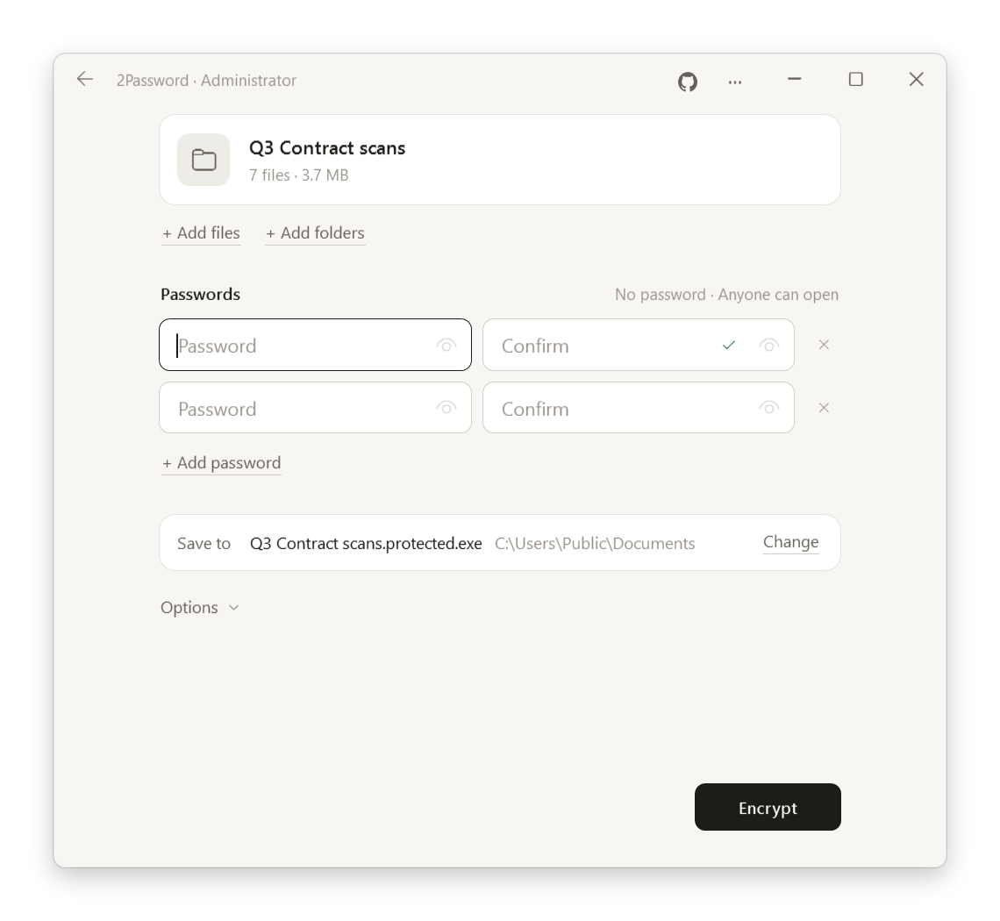

# 2Password

[English](README.md) · [简体中文](README.zh.md)

Encrypt a file or folder into a single EXE with several passwords. Any one of them opens it. The recipient double-clicks the EXE to decrypt, with nothing to install.

[](https://github.com/WAcry/2Password/actions/workflows/build-release.yml)



## What it does

- Up to 16 passwords per package. Each one unlocks everything on its own, and knowing one doesn't reveal the others.
- The EXE carries its own runtime and opens on any 64-bit Windows 10 or 11 PC.
- By default the package stores 5% PAR2 recovery data inside itself, so there are no extra files. If the package is damaged, decryption repairs a copy and decrypts that; the original file is left as it is.
- When the encrypted result is larger than 4 GB, it's split into `Documents.exe` and `Documents.2pw`, with the recovery data in the `.2pw`. Keep the two in the same folder.
- Filenames in any language (emoji included), empty folders, timestamps and file attributes come back as they were. Existing files are never overwritten.

## Download

Pick one from [Releases](https://github.com/WAcry/2Password/releases/latest):

| File | Description |
| --- | --- |
| `2Password-VERSION-win-x64-en-US.msi` | English installer. Installs for the current user, no admin rights needed |
| `2Password-VERSION-win-x64-zh-CN.msi` | Chinese installer |
| `2Password-VERSION-win-x64.exe` | Portable, runs directly |
| `2Password-VERSION-win-x64-portable.zip` | Portable EXE with the docs |

The two installers differ only in the setup wizard's language; the app switches between English and Chinese from its menu. Releases aren't code-signed, so Windows may warn about an unknown publisher. Check downloads against `SHA256SUMS.txt`.

## How to use

**Encrypt:** drag a file or folder into the window, enter passwords and click Encrypt. The finish screen lists the generated files; send them together.

**Batch encryption:** select multiple files or folders, or drop a mixed selection. Add or remove items on the encrypt screen. Each selected item becomes its own package in the chosen folder, using the same passwords and options. Conflicting names receive a number; existing files are never overwritten. Completed packages remain available after cancellation or a failure, and you can continue with the remaining items.

**Decrypt:** double-click the EXE you received and enter any one of the passwords. If you'd rather not run an EXE someone sent you, drag it into your own copy of 2Password.

**View a password:** hold the eye button beside a password field to reveal it temporarily; release to hide it. This works for passwords, confirmation fields, and decryption.

**No password:** leave a password and its confirmation blank when creating the package; the recipient can click Decrypt with an empty field. If any password pair is blank, anyone can open the entire package without a password. The interface shows this clearly.

**Repair:** choose "Repair a package…" in the ··· menu at the top right, pick the EXE or `.2pw`, and click Check, then Repair if it finds damage. Repair writes the fixed blocks back into the file.

Compression, single EXE versus EXE + `.2pw`, and the amount of recovery data are under Options on the encrypt screen.

Compression defaults to **Zstd (Lv.3)**. Choose **Brotli (Lv.6)** to favor compression ratio, or choose no compression.

**Right-click menu:** turn on "Show in right-click menu" in the ··· menu at the top right. Right-click a file or folder in Explorer and choose "Encrypt with 2Password". `.2pw` files get Decrypt. On Windows 11 these are under "Show more options".

Select multiple files and folders to send them to one encryption window. A new selection opens another window if the window is busy. The legacy Windows menu supports up to 100 selected items by default; use drag and drop or the application's selection dialogs for larger batches. Running an updated copy refreshes an already-enabled older menu.

**Administrator rights:** saving or decrypting into a location like Program Files fails with an access-denied message. Click "Retry as administrator" next to it. The chosen files and location carry over; enter the passwords again. The ··· menu also has "Run as administrator".

## Tips

- Every password opens the whole package by itself. Empty and single-character passwords are allowed; use a strong password in every row when you need confidentiality.
- A package you've sent can't be taken back. To change passwords, encrypt a new copy.
- Decrypt to an NTFS drive. FAT32 and exFAT USB sticks can carry packages but can't be the decryption destination.
- Keep the `.2pw` file in the same folder as the EXE.
- Download OneDrive "online-only" files before encrypting them. Symbolic links and junctions can't be packaged.
- Turn off "Show in right-click menu" before moving or deleting the portable EXE. Uninstalling the installed version removes the menu entries.

## Command line

```text
2Password.exe --help
2Password.exe --create Documents --output Documents.exe --passwords-stdin
2Password.exe --extract Documents.exe --output NewFolder --password-stdin
```

Passwords are read only from standard input: a JSON array of strings when creating, a single line when extracting. Use `[""]` to create a package without a password, then submit an empty line or end input to decrypt it. `--help` lists every option, including checking and repairing recovery data. `--language en` or `--language zh-CN` sets the message language.

## Security

Each password goes through Argon2id (64 MiB) to derive its own key, and that key wraps the package's content key with AES-256-GCM. File contents and names are inside the encrypted data. The package's filename, size, password count and file count are visible. See [Security design](docs/SECURITY.md) and the [format specification](src/TwoPassword.Core/CoreDesign.md).

## Building from source

Requires 64-bit Windows and .NET SDK 10.0.114 (pinned in `global.json`).

```powershell
git clone https://github.com/WAcry/2Password.git
cd 2Password
pwsh -File scripts/Build-Release.ps1
```

The script runs the tests, then writes the installers, the portable build and checksums to `artifacts/release/`. [Validation records](docs/VALIDATION.md) describe what the tests cover. Pushing a tag such as `v1.2.3` makes GitHub Actions build, verify and publish a release.

## Third-party components

Encryption uses .NET's AES-GCM and Konscious Argon2. Compression uses ZstdSharp and .NET Brotli. Recovery data comes from par2cmdline-turbo 1.5.0, and the installers are built with WiX 4. Licenses are in [THIRD-PARTY-NOTICES.txt](THIRD-PARTY-NOTICES.txt). par2cmdline-turbo is GPL-licensed; its complete source ships with every release and can be exported from Open-source licenses in the app menu.
